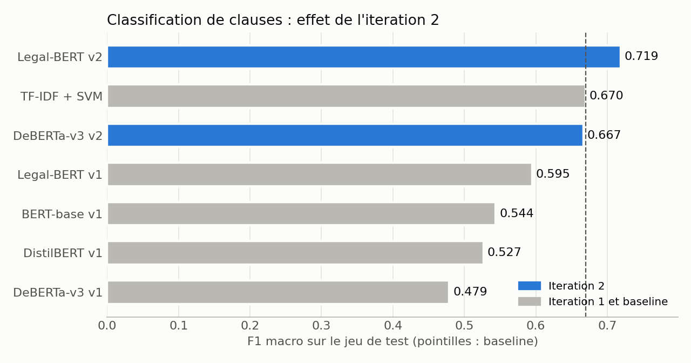
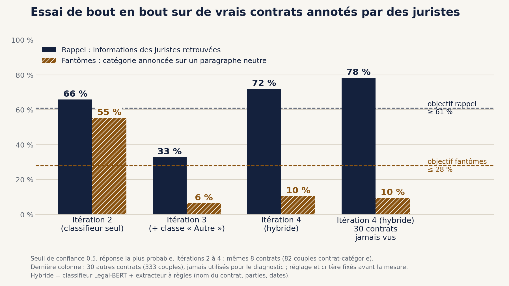

# Agent d'audit de conformité documentaire

Système qui analyse un contrat et produit un rapport d'audit clause par clause :
pour chaque clause, un verdict (conforme, non conforme, à vérifier, manquante),
une justification et la citation de l'article de loi applicable.

**Projet Big Data & Deep Learning — 5ème année Ingénierie Data Science & IA**

---

## Le problème

La vérification de conformité d'un contrat est aujourd'hui faite à la main par un
juriste, clause par clause : environ 3 heures pour un contrat de 40 pages (estimation de
départ du projet). Le travail est coûteux, difficile à tracer, et les clauses manquantes
sont faciles à rater. Ce projet automatise cette vérification.

---

## Architecture

```
Contrat PDF / DOCX
      |
      v
[1] Extraction du texte (OCR si le document est scanné)                     à faire
      |
      v
[2] Découpage en clauses (src/data/segment.py)                              terminé
      |
      +------------------------------+
      v                              v
[3a] Classification du type      [3b] Extraction de l'identité du contrat
     de clause (Legal-BERT v4,        par règles (src/data/header.py) :
     37 catégories + « Autre »)       nom, parties, date de signature,
                                      date d'entrée en vigueur                terminé
      |
      v
[4] Recherche de la règle et de l'article de loi (BGE-M3)                   terminé
      ^
      |  veille juridique : les nouvelles lois entrent dans le corpus sans réentraînement
      |
      v
[5] Jugement de conformité (LLM)                                            à faire
      |
      v
[6] Rapport d'audit  ->  [7] API + interface web + monitoring               à faire
      |
      v
   Correction par un juriste --> réentraînement
```

Couche Big Data prévue : ingestion en flux (Kafka), traitement distribué (Spark),
stockage en data lake.

**Pourquoi deux composants à l'étape 3.** Quatre des 41 catégories CUAD (nom du contrat, parties,
date de signature, date d'entrée en vigueur) ne sont pas des clauses mais de petits passages de
16 à 25 caractères dans l'en-tête ou le bloc de signature. Un classifieur paragraphe par paragraphe
retrouvait mal en conditions réelles : sur 8 contrats, les catégories d'en-tête (ces quatre plus la date
d'expiration) étaient retrouvées 5 fois sur 35. Des règles explicites, mesurables sur des contrats
annotés, sont plus fiables (voir « Extraction de l'identité du contrat »).

---

## Données

**CUAD** (Contract Understanding Atticus Dataset) : 510 contrats commerciaux
réels, annotés par des juristes sur 41 catégories de clauses.

| Étape | Volume |
| --- | --- |
| Corpus brut (v1, versionné DVC) | 1,7 Go |
| Contrats (entraînement / test) | 408 / 102 |
| Clauses étiquetées (v2) | 10 134 clauses, 41 catégories |
| Entraînement / test | 8 222 / 1 912 clauses |

Le jeu est déséquilibré : les catégories fréquentes dépassent 500 exemples,
les plus rares en ont moins de 20. C'est ce qui explique le choix du **F1 macro**
comme métrique principale : il donne le même poids à chaque catégorie, rare ou
fréquente.

---

## Résultats : classification des clauses isolées

Sept modèles comparés sur le même jeu de test, tous tracés dans MLflow
(expérience `01-classification-clauses`).

| Modèle | Itération | F1 macro | Accuracy | F1 pondéré |
| --- | --- | --- | --- | --- |
| Legal-BERT (pondéré) | 2 | 0,719 | 0,792 | 0,793 |
| TF-IDF + SVM (baseline) | — | 0,670 | 0,750 | 0,740 |
| DeBERTa-v3-small (pondéré) | 2 | 0,667 | 0,746 | 0,741 |
| Legal-BERT | 1 | 0,595 | 0,768 | 0,740 |
| BERT-base | 1 | 0,544 | 0,732 | 0,699 |
| DistilBERT | 1 | 0,527 | 0,724 | 0,693 |
| DeBERTa-v3-small | 1 | 0,479 | 0,693 | 0,657 |



**Le pré-entraînement juridique compte** : Legal-BERT et BERT-base ont la même architecture ;
seul le pré-entraînement diffère (+5 points de F1 macro à l'itération 1).
**La pondération des classes et l'arrêt automatique** font passer Legal-BERT de 0,595 à 0,719
(+12 points) et battent la baseline.

### Itérations 3 et 4 : la classe « Autre »

Un classifieur à 41 réponses annonce une catégorie sur n'importe quel paragraphe. On lui ajoute
une 42e réponse, « Autre », apprise sur des paragraphes neutres de contrats d'entraînement.

| Itération | Classes | F1 macro (passages isolés) | F1 macro (clauses en segment) | « Autre » reconnue |
| --- | --- | --- | --- | --- |
| 3 | 41 + « Autre » | 0,735 | non mesuré | 90,4 % |
| 4 | 37 + « Autre » | 0,719 | 0,696 | 88,9 % |

Les itérations 3 et 4 ne sont pas comparables entre elles sur le F1 macro : l'itération 4 ne traite
plus les 4 catégories d'identité (voir ci-dessous). Les mesures de laboratoire ne suffisent pas :
c'est l'essai sur contrats entiers qui tranche.

---

## Résultats : essai de bout en bout sur de vrais contrats

`python scripts/eval_pipeline.py --model models/best_model_v4 --contracts 30 --fresh`

Chaque contrat est découpé en segments, classé, puis comparé aux passages annotés par les juristes.
**Rappel** : part des couples (contrat, catégorie) annotés qui sont retrouvés.
**Fantômes** : part des paragraphes sans annotation qui reçoivent quand même une catégorie.
Seuil de confiance 0,5, réponse la plus probable.

| Système | Contrats | Rappel | Fantômes |
| --- | --- | --- | --- |
| Itération 2 (classifieur seul) | 8 | 65,9 % | 55,4 % |
| Itération 3 (+ « Autre ») | 8 | 32,9 % | 6,5 % |
| Itération 4 (hybride) | 8 | 72,0 % | 10,5 % |
| **Itération 4 (hybride)** | **30, jamais utilisés pour le diagnostic** | **78,4 %** | **9,5 %** |



**Méthode.** Le critère de réussite (rappel ≥ 61 % **et** fantômes ≤ 28 %, au seuil 0,5) et le réglage
(réponse la plus probable, seuil 0,5) ont été fixés **avant** la mesure sur les 30 contrats. Ces
30 contrats n'ont pas servi au diagnostic ; les 8 premiers, si : c'est en examinant leurs résultats
qu'a été décidée la séparation des catégories d'identité. L'itération 3 avait échoué à ce même critère
(rappel 32,9 %) ; le diagnostic a alors montré que 88 % des annotations portées par des segments courts
(moins de 250 caractères) étaient des catégories d'identité : blocs de signature, titres, phrases de date
annotés « Parties », « Document Name » ou « Agreement Date ».

Sur les 30 contrats : classifieur seul, rappel 79,2 % sur 226 couples (incertitude d'environ ±3 points) ;
extracteur d'identité, 82 couples sur 107 (77 %) ; ensemble, 78,4 %. Résultats détaillés :
`reports/bout_en_bout_best_model_v4_30contrats_frais.json`.

---

## Extraction de l'identité du contrat (règles)

`src/data/header.py` : règles réglées sur les 408 contrats d'entraînement, mesurées **une seule fois** sur
les 102 contrats de test (`python scripts/eval_header.py`).

| Catégorie | Présente dans | Retrouvée | Bonne valeur (même texte) |
| --- | --- | --- | --- |
| Nom du contrat | 100 % | 100 % | 87,3 % |
| Parties | 100 % | 94,1 % | 95,8 % |
| Date de signature | 91,2 % | 86,0 % (précision 93,0 %) | 83,8 % |
| Date d'entrée en vigueur | 68,6 % | 72,9 % (précision 82,3 %) | 76,5 % |

Lecture : pour le nom et les parties, présents dans 100 % des contrats, la détection de présence n'apprend
rien, seule la bonne valeur compte. Pour la date de signature, la précision (93,0 %) dépasse à peine le
« toujours oui » (91,2 %). La date d'entrée en vigueur est le point le plus faible : 9 contrats sur 21
(43 %) sur l'échantillon de 30 contrats.

---

## Découpage d'un contrat en clauses

`src/data/segment.py`, mesuré sur les 102 contrats de test (2 643 passages annotés par des juristes) :

* **93,2 %** des passages restent entiers dans un seul segment ;
* **aucun** segment ne dépasse 1 000 caractères (la fenêtre de Legal-BERT) ;
* sans cette coupe, environ 9,5 % des paragraphes bruts dépasseraient 1 000 caractères et seraient tronqués.

---

## Résultats : recherche de la règle

Un référentiel de **41 règles contractuelles** (une par catégorie) est indexé avec le corpus de lois.
Pour chaque clause de test, la bonne règle est celle de sa catégorie CUAD. 1 912 clauses de test,
tracées dans MLflow (expérience `02-recherche-regles`).

| Méthode | Recall@1 | Recall@3 | Recall@5 | MRR |
| --- | --- | --- | --- | --- |
| BM25 (référence classique) | 0,358 | 0,595 | 0,684 | 0,481 |
| E5 multilingue, dense | 0,379 | 0,634 | 0,730 | 0,513 |
| E5 multilingue, hybride | 0,411 | 0,658 | 0,765 | 0,547 |
| **BGE-M3, dense** | **0,463** | 0,700 | **0,787** | 0,584 |
| BGE-M3, hybride | 0,458 | **0,703** | 0,785 | **0,586** |

**BGE-M3 retenu** : +10 points de Recall@5 sur BM25. Corpus réel indexé : RGPD (99 articles, 88 pages) et
loi organique tunisienne n° 2004-63 (105 articles), soit 245 articles avec les règles.

**Sources des règles.** Les 41 règles sont des contrôles formulés par l'équipe, chacun rattaché à la
définition officielle de sa catégorie dans CUAD (The Atticus Project), conservée avec la règle.
Ce ne sont pas des articles de loi.

---

## Veille juridique : les nouvelles lois sont prises en compte automatiquement

Une nouvelle loi ne demande **aucun réentraînement** : la connaissance juridique vit dans le
corpus et l'index de recherche, pas dans les poids des modèles. Legal-BERT classe le *type*
de clause, qui ne change pas quand la loi change.

À chaque passage, `src/retrieval/law_watch.py` :

1. relit les sources de `configs/law_sources.yaml` (RGPD, loi 2004-63, règles, dossier de dépôt) ;
2. découpe les textes par article et compare leur empreinte à celle déjà connue ;
3. note ce qui est **ajouté, modifié ou abrogé** dans un journal (l'ancienne version est conservée) ;
4. repère les textes du type « loi n° X modifiant la loi n° Y » (toutes les variantes typographiques
   rencontrées dans de vrais PDF tunisiens) et marque la loi visée **« à vérifier »** ;
5. ne ré-encode que les articles nouveaux ou modifiés, puis rafraîchit l'index ;
6. trace le passage dans MLflow, avec une **version du corpus** à inscrire dans chaque rapport d'audit.

**Source du Journal officiel (JORT).** Le site n'offre pas de flux automatique : le texte d'un nouveau
numéro est déposé en PDF dans `data/law_inbox`, la veille le lit, le découpe en articles et signale la loi
qu'il modifie. L'interrogation automatique du site n'est pas activée.

Démonstration (loi fictive) : `python scripts/demo_veille.py`

---

## Limites connues

- Contrats en anglais et droit américain (CUAD) ; ouverture au français et au droit tunisien prévue.
- Les 41 règles sont des **contrôles de l'équipe**, fondés sur les définitions CUAD ; elles n'ont pas fait
  l'objet d'une relecture juridique.
- L'évaluation de bout en bout repose sur 30 contrats (333 couples) ; sa précision est d'environ ±3 points.
  Un « fantôme » est un paragraphe non annoté par CUAD, qui peut être pertinent sans l'avoir été.
- Catégories encore mal retrouvées sur l'échantillon : Renewal Term (3 sur 8), License Grant (6 sur 12),
  Ip Ownership Assignment (4 sur 7), Post-Termination Services (3 sur 5).
- Date d'entrée en vigueur : extraction à améliorer (43 % sur l'échantillon de 30 contrats).
- Le Journal officiel est alimenté par dépôt de PDF, non par interrogation automatique.
- Jeu de données modeste pour le deep learning (10 134 clauses, catégories rares sous 20 exemples) : compensé
  par un modèle pré-entraîné sur des textes juridiques et une perte pondérée.

---

## Reproduire

- Baseline : `python -m src.models.classify_baseline`
- Itérations 1 et 2 : `notebooks/benchmark_transformers_colab_v2.ipynb`, `notebooks/iteration2_colab.ipynb` (Colab, GPU T4)
- Itération 3 : `notebooks/iteration3_colab.ipynb` ; itération 4 : `notebooks/iteration4_colab.ipynb`
- Données de l'itération 4 : `python scripts/build_autre.py`
- Import des résultats Colab dans MLflow : `python -m src.models.log_benchmark reports/benchmark_v4.json`
- Règles : `python scripts/build_rules.py`
- Recherche : `python -m src.retrieval.eval_retrieval` ; embeddings : `notebooks/retrieval_dense_colab.ipynb`
- Veille juridique : `python -m src.retrieval.law_watch`
- Extraction d'identité : `python scripts/eval_header.py`
- Découpage : `python scripts/eval_segmentation.py`
- Essai de bout en bout : `python scripts/eval_pipeline.py --model models/best_model_v4 --contracts 30 --fresh --mlflow`
- Tests : `python -m pytest tests/test_law_watch.py tests/test_segment.py tests/test_autre.py tests/test_header.py -q` (50 tests)

---

## Stack technique

| Outil | Usage dans le projet |
| --- | --- |
| GitHub | Versionnement du code, historique des contributions |
| DVC | Versionnement des données et des modèles |
| MLflow | Suivi des expériences : classification, recherche, veille, bout en bout |
| Hugging Face Transformers | Fine-tuning de BERT, Legal-BERT, DeBERTa |
| sentence-transformers | Encodeurs E5 multilingue et BGE-M3 |
| rank-bm25 | Recherche lexicale de référence (BM25) |
| pdfplumber | Lecture des PDF de lois |
| Google Colab (GPU T4) | Entraînement des Transformers, mesure des encodeurs |
| scikit-learn | Baseline TF-IDF + SVM, métriques |
| FastAPI, Docker | Service d'audit (à faire) |

---

## Démarrage rapide

```powershell
# Environnement (Windows)
python -m venv .venv
.\.venv\Scripts\Activate.ps1
pip install -r requirements.txt

# Données
python -m src.data.download
python -m src.data.prepare

# Baseline
python -m src.models.classify_baseline

# Suivi des expériences
mlflow ui --port 5000          # http://localhost:5000
```

---

## Structure du dépôt

```
.
├── configs/         # sources de la veille juridique
├── data/
│   ├── rules/       # 41 règles + 9 contrôles RGPD + définitions CUAD
│   ├── corpus/      # corpus de lois article par article, journal des changements
│   └── ...          # données, gérées par DVC (non versionnées par Git)
├── models/          # modèles entraînés, gérés par DVC
├── notebooks/       # notebooks Colab (entraînements, mesure de la recherche)
├── reports/         # métriques, tableaux, graphiques, résultats de bout en bout
├── scripts/         # veille, évaluations, préparation des données, démonstrations
├── src/
│   ├── data/        # découpage en clauses, extraction d'identité, exemples « Autre », mesures
│   ├── models/      # classification des clauses (entraînement, inférence)
│   ├── retrieval/   # corpus de lois, index, veille juridique, évaluation
│   ├── judge/       # jugement de conformité
│   └── api/         # service FastAPI
├── tests/
├── docs/            # fiche projet, diagrammes, captures
├── dvc.yaml         # pipeline de données reproductible
└── params.yaml      # hyperparamètres
```

---

## État d'avancement

| Phase | Contenu | État |
| --- | --- | --- |
| 1. Fondations | Dépôt, DVC, MLflow, données CUAD | Terminé |
| 2. Classification | Legal-BERT v4 (37 catégories + « Autre »), extracteur d'identité, critère de bout en bout atteint sur 30 contrats jamais vus | Terminé |
| 2 bis. Découpage | Découpage d'un contrat en clauses, 93 % des passages entiers | Terminé |
| 3. Référentiel et corpus de lois | 41 règles sourcées sur CUAD, RGPD (99 articles), loi 2004-63 (105 articles) | Terminé |
| 4. Recherche et veille juridique | BGE-M3 (Recall@5 0,787), mise à jour automatique des lois, dépôt de PDF du JORT | Terminé |
| 5. Jugement | LLM qui évalue la conformité et cite l'article | À faire |
| 6. Big Data | Kafka, Spark, data lake | À faire |
| 7. Produit | Lecture de PDF, rapport, API, interface web, Docker | À faire |
| 8. MLOps avancé | Orchestration, CI/CD, monitoring | À faire |
| 9. Soutenance | Démo, rapport final | À faire |

---

## Équipe

| Membre | Rôle |
| --- | --- |
| Sourour BEN SALHA | À compléter |
| Ghayth AOUISSAOUI | À compléter |
