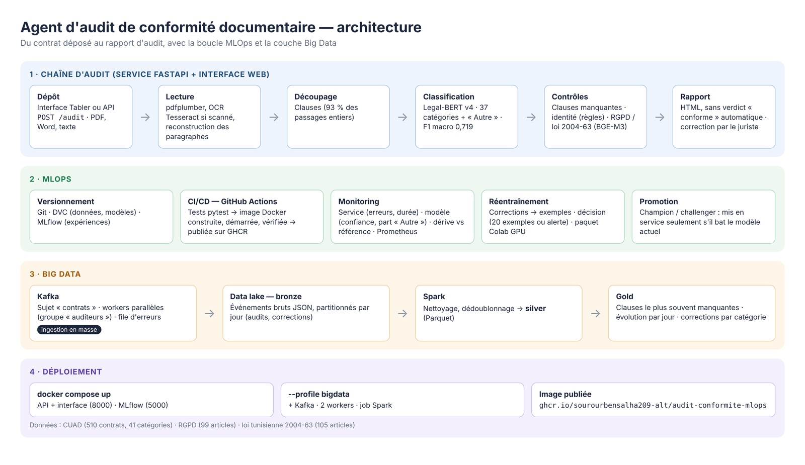
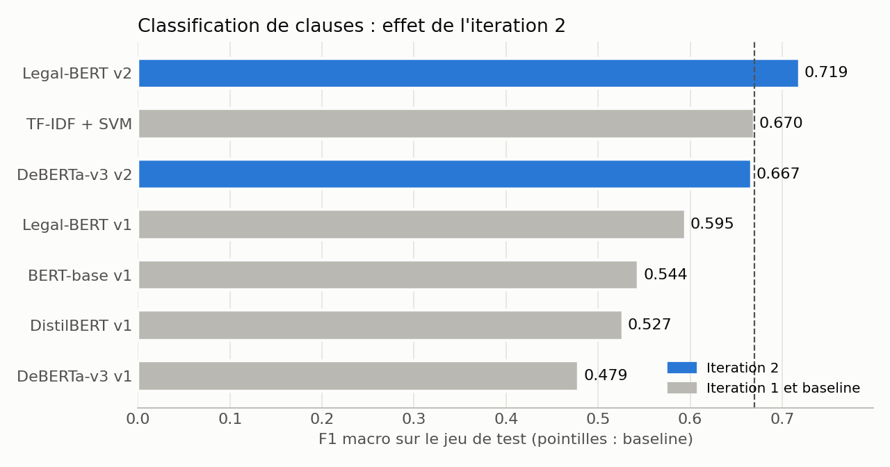
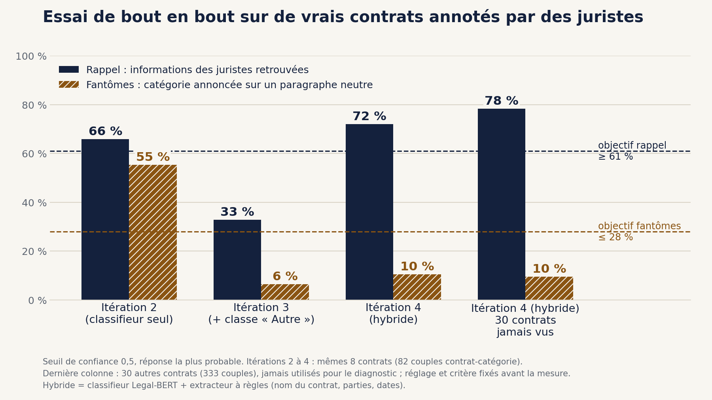
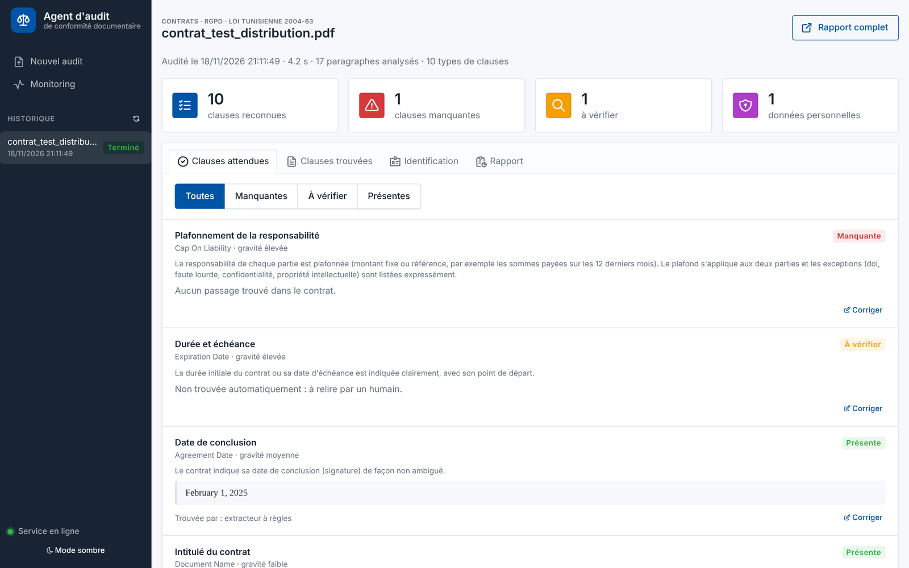
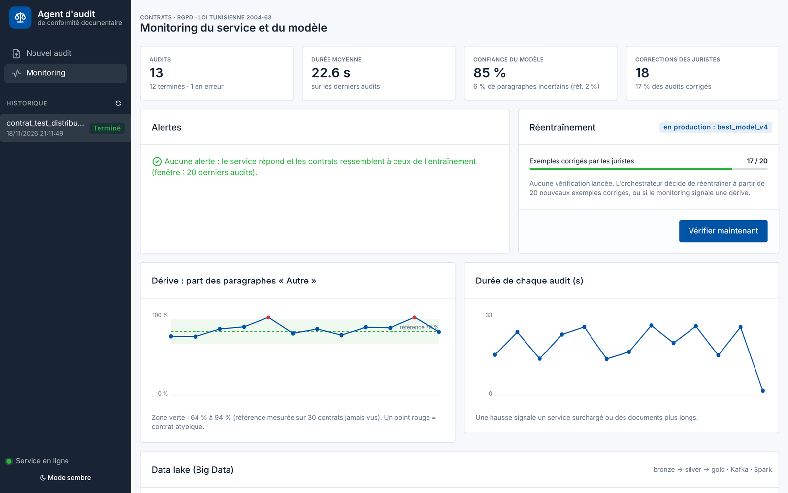
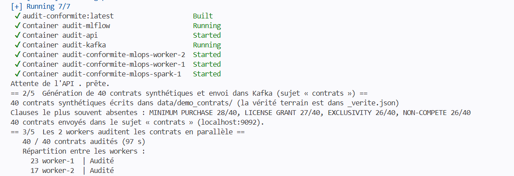
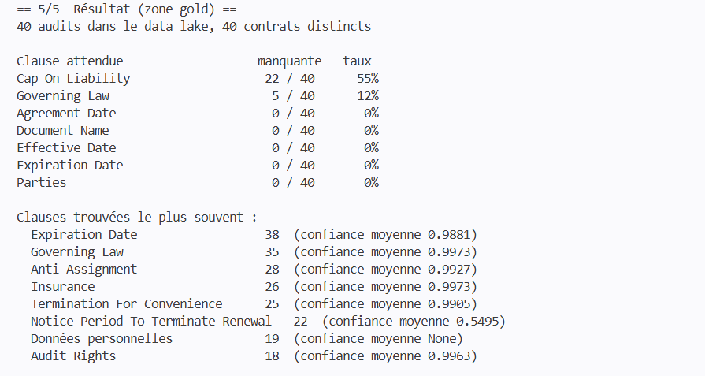
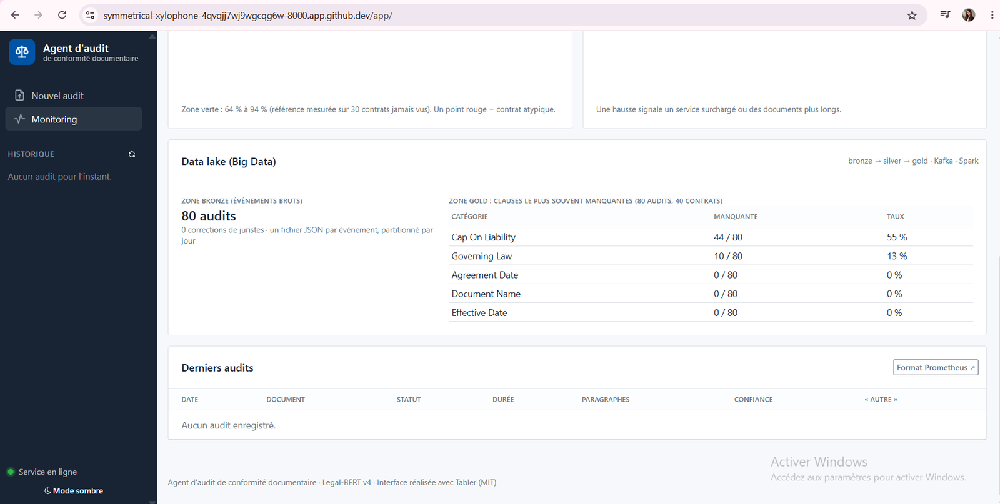
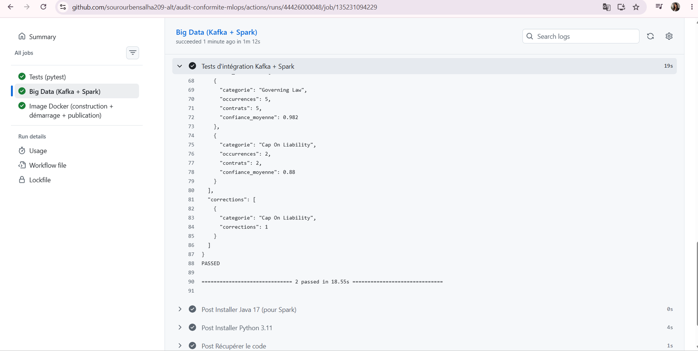

# Agent d'audit de conformité documentaire

[](https://github.com/sourourbensalha209-alt/audit-conformite-mlops/actions/workflows/ci.yml)
[](https://github.com/sourourbensalha209-alt/audit-conformite-mlops/pkgs/container/audit-conformite-mlops)
[](https://dagshub.com/sourourbensalha209-alt/audit-conformite-mlops)

Système qui analyse un contrat (PDF, Word ou texte) et produit un rapport d'audit clause par clause : il
reconnaît le type de chaque clause, signale les clauses attendues qui manquent, rattache chaque clause à sa
règle de contrôle et, pour les données personnelles, aux articles du RGPD et de la loi tunisienne 2004-63.
Il ne rend pas de verdict « conforme / non conforme » automatique (voir « Phase 5 ») : c'est un **assistant de
tri** pour le juriste, qui relit, corrige, et dont les corrections servent à réentraîner le modèle.

**Projet Big Data & Deep Learning — 5ème année Ingénierie Data Science & IA**



---

## Le problème

La vérification de conformité d'un contrat est aujourd'hui faite à la main par un
juriste, clause par clause : environ 3 heures pour un contrat de 40 pages (estimation de
départ du projet). Le travail est coûteux, difficile à tracer, et les clauses manquantes
sont faciles à rater. Ce projet automatise cette vérification.

---

## Architecture

```
Contrat PDF / DOCX
      |
      v
[1] Extraction du texte : PDF (pdfplumber, OCR si scanné), Word, texte    terminé
      |
      v
[2] Découpage en clauses (src/data/segment.py)                              terminé
      |
      +------------------------------+
      v                              v
[3a] Classification du type      [3b] Extraction de l'identité du contrat
     de clause (Legal-BERT v4,        par règles (src/data/header.py) :
     37 catégories + « Autre »)       nom, parties, date de signature,
                                      date d'entrée en vigueur                terminé
      |
      v
[4] Recherche de la règle et de l'article de loi (BGE-M3)                   terminé
      ^
      |  veille juridique : les nouvelles lois entrent dans le corpus sans réentraînement
      |
      v
[5] Clauses manquantes (validé) + verdict conforme / non conforme (LLM ouvert : non validé)   évalué
      |
      v
[6] Rapport d'audit (page HTML, scripts/audit_contract.py)                   fait
      |
      v
[7] API FastAPI + interface web + Docker + CI/CD + monitoring               terminé
      |
      v
   Correction par un juriste --> réentraînement (orchestrateur + promotion)   terminé

Couche Big Data : contrats en masse --> Kafka --> workers d'audit en parallèle
                  --> data lake (bronze) --> Spark (silver, gold)              terminé
```

**Pourquoi deux composants à l'étape 3.** Quatre des 41 catégories CUAD (nom du contrat, parties,
date de signature, date d'entrée en vigueur) ne sont pas des clauses mais de petits passages de
16 à 25 caractères dans l'en-tête ou le bloc de signature. Un classifieur paragraphe par paragraphe
retrouvait mal en conditions réelles : sur 8 contrats, les catégories d'en-tête (ces quatre plus la date
d'expiration) étaient retrouvées 5 fois sur 35. Des règles explicites, mesurables sur des contrats
annotés, sont plus fiables (voir « Extraction de l'identité du contrat »).

---

## Données

**CUAD** (Contract Understanding Atticus Dataset) : 510 contrats commerciaux
réels, annotés par des juristes sur 41 catégories de clauses.

| Étape | Volume |
| --- | --- |
| Corpus brut (v1, versionné DVC) | 1,7 Go |
| Contrats (entraînement / test) | 408 / 102 |
| Clauses étiquetées (v2) | 10 134 clauses, 41 catégories |
| Entraînement / test | 8 222 / 1 912 clauses |

Le jeu est déséquilibré : les catégories fréquentes dépassent 500 exemples,
les plus rares en ont moins de 20. C'est ce qui explique le choix du **F1 macro**
comme métrique principale : il donne le même poids à chaque catégorie, rare ou
fréquente.

---

## Résultats : classification des clauses isolées

Sept modèles comparés sur le même jeu de test, tous tracés dans MLflow
(expérience `01-classification-clauses`).

| Modèle | Itération | F1 macro | Accuracy | F1 pondéré |
| --- | --- | --- | --- | --- |
| Legal-BERT (pondéré) | 2 | 0,719 | 0,792 | 0,793 |
| TF-IDF + SVM (baseline) | — | 0,670 | 0,750 | 0,740 |
| DeBERTa-v3-small (pondéré) | 2 | 0,667 | 0,746 | 0,741 |
| Legal-BERT | 1 | 0,595 | 0,768 | 0,740 |
| BERT-base | 1 | 0,544 | 0,732 | 0,699 |
| DistilBERT | 1 | 0,527 | 0,724 | 0,693 |
| DeBERTa-v3-small | 1 | 0,479 | 0,693 | 0,657 |



**Le pré-entraînement juridique compte** : Legal-BERT et BERT-base ont la même architecture ;
seul le pré-entraînement diffère (+5 points de F1 macro à l'itération 1).
**La pondération des classes et l'arrêt automatique** font passer Legal-BERT de 0,595 à 0,719
(+12 points) et battent la baseline.

### Itérations 3 et 4 : la classe « Autre »

Un classifieur à 41 réponses annonce une catégorie sur n'importe quel paragraphe. On lui ajoute
une 42e réponse, « Autre », apprise sur des paragraphes neutres de contrats d'entraînement.

| Itération | Classes | F1 macro (passages isolés) | F1 macro (clauses en segment) | « Autre » reconnue |
| --- | --- | --- | --- | --- |
| 3 | 41 + « Autre » | 0,735 | non mesuré | 90,4 % |
| 4 | 37 + « Autre » | 0,719 | 0,696 | 88,9 % |

Les itérations 3 et 4 ne sont pas comparables entre elles sur le F1 macro : l'itération 4 ne traite
plus les 4 catégories d'identité (voir ci-dessous). Les mesures de laboratoire ne suffisent pas :
c'est l'essai sur contrats entiers qui tranche.

---

## Résultats : essai de bout en bout sur de vrais contrats

`python scripts/eval_pipeline.py --model models/best_model_v4 --contracts 30 --fresh`

Chaque contrat est découpé en segments, classé, puis comparé aux passages annotés par les juristes.
**Rappel** : part des couples (contrat, catégorie) annotés qui sont retrouvés.
**Fantômes** : part des paragraphes sans annotation qui reçoivent quand même une catégorie.
Seuil de confiance 0,5, réponse la plus probable.

| Système | Contrats | Rappel | Fantômes |
| --- | --- | --- | --- |
| Itération 2 (classifieur seul) | 8 | 65,9 % | 55,4 % |
| Itération 3 (+ « Autre ») | 8 | 32,9 % | 6,5 % |
| Itération 4 (hybride) | 8 | 72,0 % | 10,5 % |
| **Itération 4 (hybride)** | **30, jamais utilisés pour le diagnostic** | **78,4 %** | **9,5 %** |



**Méthode.** Le critère de réussite (rappel ≥ 61 % **et** fantômes ≤ 28 %, au seuil 0,5) et le réglage
(réponse la plus probable, seuil 0,5) ont été fixés **avant** la mesure sur les 30 contrats. Ces
30 contrats n'ont pas servi au diagnostic ; les 8 premiers, si : c'est en examinant leurs résultats
qu'a été décidée la séparation des catégories d'identité. L'itération 3 avait échoué à ce même critère
(rappel 32,9 %) ; le diagnostic a alors montré que 88 % des annotations portées par des segments courts
(moins de 250 caractères) étaient des catégories d'identité : blocs de signature, titres, phrases de date
annotés « Parties », « Document Name » ou « Agreement Date ».

Sur les 30 contrats : classifieur seul, rappel 79,2 % sur 226 couples (incertitude d'environ ±3 points) ;
extracteur d'identité, 82 couples sur 107 (77 %) ; ensemble, 78,4 %. Résultats détaillés :
`reports/bout_en_bout_best_model_v4_30contrats_frais.json`.

---

## Extraction de l'identité du contrat (règles)

`src/data/header.py` : règles réglées sur les 408 contrats d'entraînement, mesurées **une seule fois** sur
les 102 contrats de test (`python scripts/eval_header.py`).

| Catégorie | Présente dans | Retrouvée | Bonne valeur (même texte) |
| --- | --- | --- | --- |
| Nom du contrat | 100 % | 100 % | 87,3 % |
| Parties | 100 % | 94,1 % | 95,8 % |
| Date de signature | 91,2 % | 86,0 % (précision 93,0 %) | 83,8 % |
| Date d'entrée en vigueur | 68,6 % | 72,9 % (précision 82,3 %) | 76,5 % |

Lecture : pour le nom et les parties, présents dans 100 % des contrats, la détection de présence n'apprend
rien, seule la bonne valeur compte. Pour la date de signature, la précision (93,0 %) dépasse à peine le
« toujours oui » (91,2 %). La date d'entrée en vigueur est le point le plus faible : 9 contrats sur 21
(43 %) sur l'échantillon de 30 contrats.

---

## Découpage d'un contrat en clauses

`src/data/segment.py`, mesuré sur les 102 contrats de test (2 643 passages annotés par des juristes) :

* **93,2 %** des passages restent entiers dans un seul segment ;
* **aucun** segment ne dépasse 1 000 caractères (la fenêtre de Legal-BERT) ;
* sans cette coupe, environ 9,5 % des paragraphes bruts dépasseraient 1 000 caractères et seraient tronqués.

---

## Résultats : recherche de la règle

Un référentiel de **41 règles contractuelles** (une par catégorie) est indexé avec le corpus de lois.
Pour chaque clause de test, la bonne règle est celle de sa catégorie CUAD. 1 912 clauses de test,
tracées dans MLflow (expérience `02-recherche-regles`).

| Méthode | Recall@1 | Recall@3 | Recall@5 | MRR |
| --- | --- | --- | --- | --- |
| BM25 (référence classique) | 0,358 | 0,595 | 0,684 | 0,481 |
| E5 multilingue, dense | 0,379 | 0,634 | 0,730 | 0,513 |
| E5 multilingue, hybride | 0,411 | 0,658 | 0,765 | 0,547 |
| **BGE-M3, dense** | **0,463** | 0,700 | **0,787** | 0,584 |
| BGE-M3, hybride | 0,458 | **0,703** | 0,785 | **0,586** |

**BGE-M3 retenu** : +10 points de Recall@5 sur BM25. Corpus réel indexé : RGPD (99 articles, 88 pages) et
loi organique tunisienne n° 2004-63 (105 articles), soit 245 articles avec les règles.

**Sources des règles.** Les 41 règles sont des contrôles formulés par l'équipe, chacun rattaché à la
définition officielle de sa catégorie dans CUAD (The Atticus Project), conservée avec la règle.
Ce ne sont pas des articles de loi.

---

## Veille juridique : les nouvelles lois sont prises en compte automatiquement

Une nouvelle loi ne demande **aucun réentraînement** : la connaissance juridique vit dans le
corpus et l'index de recherche, pas dans les poids des modèles. Legal-BERT classe le *type*
de clause, qui ne change pas quand la loi change.

À chaque passage, `src/retrieval/law_watch.py` :

1. relit les sources de `configs/law_sources.yaml` (RGPD, loi 2004-63, règles, dossier de dépôt) ;
2. découpe les textes par article et compare leur empreinte à celle déjà connue ;
3. note ce qui est **ajouté, modifié ou abrogé** dans un journal (l'ancienne version est conservée) ;
4. repère les textes du type « loi n° X modifiant la loi n° Y » (toutes les variantes typographiques
   rencontrées dans de vrais PDF tunisiens) et marque la loi visée **« à vérifier »** ;
5. ne ré-encode que les articles nouveaux ou modifiés, puis rafraîchit l'index ;
6. trace le passage dans MLflow, avec une **version du corpus** à inscrire dans chaque rapport d'audit.

**Source du Journal officiel (JORT).** Le site n'offre pas de flux automatique : le texte d'un nouveau
numéro est déposé en PDF dans `data/law_inbox`, la veille le lit, le découpe en articles et signale la loi
qu'il modifie. L'interrogation automatique du site n'est pas activée.

Démonstration (loi fictive) : `python scripts/demo_veille.py`

---

## Phase 5 : jugement de conformité

CUAD ne contient aucun verdict de conformité : il n'existe pas de « bonne réponse » officielle. Les critères de réussite ont été
écrits et versionnés **avant** toute mesure (`docs/criteres_phase5.md`) ; les annotations de référence ont été versionnées avant de lire
la moindre réponse du modèle.

### 1. Clauses manquantes (sans modèle de langage) : critère atteint

Une catégorie attendue est « manquante » si aucun segment ne la reçoit (confiance 0,5) et si l'extracteur ne trouve rien. Mesuré sur
les 30 contrats de confirmation, contre les annotations des juristes CUAD (`python scripts/eval_missing.py`) :

| | Résultat | Repère |
| --- | --- | --- |
| Précision de « manquante » | **62,5 %** | 22,4 % si on disait toujours « manquante » (taux de base) |
| Rappel de « manquante » | **74,5 %** | critère : 60 % et 50 % : atteint |

Le résultat n'est pas uniforme : pour la responsabilité plafonnée (18 absences trouvées sur 20) et la loi applicable (7 sur 7), il n'y a
**aucune fausse alerte** ; pour les dates et les parties, trouvées par l'extracteur, « manquante » est souvent faux (par exemple 4 bonnes
détections sur 13 pour la date d'entrée en vigueur). Le rapport écrira donc « à vérifier » plutôt que « manquante » pour ces catégories.

### 2. Verdict conforme / non conforme par un modèle ouvert : critères non atteints

Deux modèles ouverts (Qwen2.5-1.5B et 3B, fp16, décodage glouton, sans réglage de la consigne) ont jugé 115 cas : 65 clauses réelles
annotées par l'équipe, et 50 paires sans rapport (clause + règle étrangère, ou paragraphe neutre) dont le bon verdict est « à vérifier ».

| Condition « avec règle » | JSON valide | Sources inventées | Abstention hors sujet | Accord équipe | Fausse abstention |
| --- | --- | --- | --- | --- | --- |
| Critère fixé d'avance | ≥ 95 % | ≤ 5 % | ≥ 70 % | ≥ 64 % | ≤ 30 % |
| Qwen2.5-1.5B | 97,4 % | 0,0 % | **2,0 %** | **52,5 %** | 0,0 % |
| Qwen2.5-3B | 100 % | 0,0 % | 100 % | **26,2 %** | **97,8 %** |

Ce que répondent vraiment les modèles : le 1,5B dit « conforme » à 108 cas sur 115, y compris à des règles sans rapport avec la clause ;
le 3B dit « à vérifier » à 114 cas sur 115. L'écart entre leur abstention sur les paires sans rapport et sur les paires liées est de
+2,0 et +1,5 points (mesure ajoutée après le premier essai) : **aucun des deux ne distingue** une clause qui concerne la règle d'une
clause qui n'en parle pas. Fournir la règle ne change rien (accord de 52,5 % contre 54,1 % sans règle pour le 1,5B ; 26,2 % dans les
deux cas pour le 3B). Le « 100 % d'abstention » du 3B n'est donc pas un succès : il s'abstient partout.

**Décision.** Ces modèles ne sont pas retenus pour rendre un verdict. Le rapport d'audit fonctionne en **assistant de tri** : il signale
les clauses manquantes là où c'est fiable, retrouve la règle de contrôle et l'article de loi applicables, et marque « à vérifier » ce qui
demande un relecteur humain, sans verdict automatique « conforme / non conforme ».

**Deux corrections de la mesure, faites après le premier essai et publiées avec lui** (commit `d54c907`) : (1) un modèle écrivait
`["[]"]` pour dire « aucune source », ce que la première version du contrôle comptait comme une source inventée (3B : 71,3 % avant
correction, 0,0 % après) ; (2) ajout de la mesure de discrimination. Les critères et les cas n'ont pas été modifiés.

### Limites de cette évaluation

- La référence est celle de deux étudiantes, pas de juristes : accord de 60 % sur 10 cas partagés (kappa 0,23), donc faible. Le seuil
  d'accord retenu (64 %) dépassait cet accord humain : défaut du critère fixé d'avance, signalé ici.
- Deux petits modèles, sans exemples dans la consigne et sans réglage : ce résultat n'exclut pas qu'un modèle plus gros ou une consigne
  plus riche fasse mieux, il établit que ces deux-là ne suffisent pas.
- Le corpus de lois ne contient que le RGPD et la loi tunisienne 2004-63 : seules les clauses sur les données personnelles peuvent citer
  un article de loi.

---

## Rapport d'audit d'un contrat

`python scripts/audit_contract.py --cuad TUNIU` produit une page HTML autonome (sans serveur, sans internet) avec : l'identité du contrat
(nom, parties, dates), les clauses attendues (présente, manquante ou à vérifier), et les clauses retrouvées avec leur règle de contrôle et
les contrôles RGPD à vérifier. Le rapport ne rend aucun verdict « conforme / non conforme » (voir « Phase 5 ») : « manquante » n'est affirmé
que pour la responsabilité plafonnée et la loi applicable, où la mesure n'a donné aucune fausse alerte ; pour les autres catégories, il écrit
« à vérifier ». Pour les 30 contrats de confirmation, le rapport sort instantanément à partir des calculs enregistrés.
`python scripts/build_interface.py` rassemble ces 30 rapports dans une seule page (liste déroulante, vue d'ensemble, boutons précédent et suivant) :
une interface de démonstration, sans serveur ni modèle.

---

## Produit : API et interface web

`uvicorn src.api.main:app` puis http://localhost:8000 : on dépose un contrat (PDF, Word ou texte), l'audit tourne en
tâche de fond et le résultat s'affiche (clauses attendues, clauses trouvées, identification, rapport complet).


*Capture de l'interface sur le contrat de démonstration `contrat_test_distribution.pdf` (données de démonstration).*

- **Lecture des PDF** (`src/data/paragraphs.py`) : pdfplumber rend une ligne par ligne imprimée, sans ligne vide entre
  paragraphes ; les paragraphes sont reconstruits (titres numérotés, majuscules, fin de phrase) avant le découpage.
  Un renvoi du type « … conformément à / Section 8. » n'ouvre pas une nouvelle clause.
- **Chaîne d'audit** (`src/pipeline.py`) : lecture → découpage → Legal-BERT → clauses manquantes → rapport, avec le modèle
  chargé une seule fois.
- **API** (`src/api/main.py`) : `POST /audit`, `GET /audit/{id}`, `GET /audit/{id}/rapport`, `POST /feedback`,
  `GET /monitoring`, `GET /metrics`, `GET /reentrainement`, `GET /bigdata`. Documentation : http://localhost:8000/docs
- **Interface** (`frontend/` : `index.html`, `app.css`, `app.js`) : JavaScript standard, mise en page Tabler (MIT, copiée
  dans `frontend/vendor/` pour fonctionner hors connexion). Le juriste peut **corriger** chaque résultat.
- **Contrôle RGPD sur tous les paragraphes** : CUAD n'a pas de catégorie « données personnelles », le classifieur range
  donc ces clauses dans « Autre ». Le contrôle par mots-clés s'applique quand même ; l'interface indique la source
  (« détectée par mots-clés RGPD ») et ces clauses ne sont pas comptées comme reconnues par le modèle.

---

## MLOps

| Brique | Mise en œuvre |
| --- | --- |
| Versionnement | Git ; DVC pour les données et les modèles, stockage distant **DagsHub** (`dvc pull models/best_model_v4.dvc`) ; MLflow pour les expériences |
| Conteneurisation | `Dockerfile` (Python 3.11, OCR, PyTorch CPU) ; le modèle n'est pas dans l'image, il est monté en lecture seule. `docker-compose.yml` : API + interface, MLflow ; profil `bigdata` : Kafka et 2 workers ; Spark à la demande |
| CI/CD (GitHub Actions) | À chaque push : tests (pytest) → tests d'intégration Big Data (vrai Kafka, vrai Spark) → image Docker construite, **démarrée et vérifiée** (API + interface) → **publiée** sur GitHub Container Registry |
| Monitoring (`src/monitoring.py`) | Chaque audit est tracé. Service : erreurs, durée. Modèle : confiance moyenne, part de paragraphes incertains, part « Autre ». **Dérive** : comparaison à la référence mesurée sur 30 contrats jamais vus (79,4 % « Autre », 1,8 % d'abstention), à partir de 5 audits. Format Prometheus sur `/metrics` |
| Réentraînement (`src/orchestration/`) | Les corrections portant un passage et sa bonne catégorie deviennent des exemples étiquetés. L'orchestrateur décide de réentraîner à 20 nouveaux exemples, ou sur alerte du monitoring avec au moins 5 exemples, et prépare le paquet pour le notebook Colab (GPU) ; décisions tracées dans MLflow |
| Promotion (champion / challenger) | `python -m src.orchestration.promote models/best_model_v5` : mis en service seulement si le F1 macro est meilleur, sans recul de plus d'un point sur les catégories rares, sur le **même** jeu de test et les mêmes étiquettes. `models/production.json` sert de registre |


*Page Monitoring (données de démonstration) : indicateurs, alertes, réentraînement, dérive, data lake.*

Image publiée : `docker pull ghcr.io/sourourbensalha209-alt/audit-conformite-mlops:latest`

---

## Big Data : Kafka, Spark, data lake

- **Data lake** (`src/bigdata/lake.py`, architecture médaillon) : chaque audit et chaque correction est versé dans la
  zone **bronze** (un fichier JSON par événement, partitionné par jour, écriture atomique, sans le texte du contrat).
- **Kafka** (`src/bigdata/stream.py`) : sujet `contrats` (3 partitions), workers du groupe `auditeurs` qui se partagent
  les partitions, résultats dans `audits`, contrats illisibles dans `contrats.erreurs`. Un message n'est validé
  qu'après son traitement (« au moins une fois »).
- **Spark** (`src/bigdata/spark_job.py`) : bronze → **silver** (Parquet, typé, dédoublonné) → **gold** (clauses le plus
  souvent manquantes, évolution par jour, clauses trouvées, corrections par catégorie).

**Démonstration réelle** (GitHub Codespaces, `bash scripts/demo_bigdata.sh`) : 40 contrats synthétiques
(`scripts/generer_contrats_demo.py`, banque de clauses écrite pour le projet, vérité terrain connue) envoyés dans
Kafka, audités par 2 workers en parallèle (23 et 17 contrats, 97 s), puis agrégés par Spark.

| Clause | Présente (vérité) | Résultat du système |
| --- | --- | --- |
| Limitation de responsabilité | 18 / 40 | 22 manquantes sur 40 : exact |
| Droit applicable | 35 / 40 | 5 manquantes sur 40 : exact |
| Durée / échéance, données personnelles, droit d'audit, assurance, cession, résiliation sans motif | 38, 19, 18, 26, 28, 25 | mêmes nombres retrouvés |
| Renouvellement automatique | 22 / 40 | 22 retrouvées, mais classées « Notice Period To Terminate Renewal » (confiance 0,55) : confusion entre deux catégories voisines |

Ces contrats synthétiques valident la **chaîne** Kafka → workers → data lake → Spark ; ils ne servent pas à évaluer le
modèle, mesuré sur CUAD (sections précédentes).

| Kafka : 2 workers | Spark : zone gold |
| --- | --- |
|  |  |




---

## Limites connues

- Contrats en anglais et droit américain (CUAD) ; ouverture au français et au droit tunisien prévue.
- Les 41 règles sont des **contrôles de l'équipe**, fondés sur les définitions CUAD ; elles n'ont pas fait
  l'objet d'une relecture juridique.
- L'évaluation de bout en bout repose sur 30 contrats (333 couples) ; sa précision est d'environ ±3 points.
  Un « fantôme » est un paragraphe non annoté par CUAD, qui peut être pertinent sans l'avoir été.
- Catégories encore mal retrouvées sur l'échantillon : Renewal Term (3 sur 8), License Grant (6 sur 12),
  Ip Ownership Assignment (4 sur 7), Post-Termination Services (3 sur 5).
- Date d'entrée en vigueur : extraction à améliorer (43 % sur l'échantillon de 30 contrats).
- Le Journal officiel est alimenté par dépôt de PDF, non par interrogation automatique.
- Le verdict « conforme / non conforme » n'est pas automatisé : les deux modèles ouverts testés ne distinguent pas les cas (voir « Phase 5 »).
- Jeu de données modeste pour le deep learning (10 134 clauses, catégories rares sous 20 exemples) : compensé
  par un modèle pré-entraîné sur des textes juridiques et une perte pondérée.
- Renouvellement automatique et préavis de non-renouvellement sont parfois confondus (vu aussi dans la démonstration Big Data).
- Le service garde les tâches d'audit en mémoire (une seule instance) ; le journal du monitoring, les corrections et le
  data lake sont, eux, écrits sur disque.
- Un message Kafka est limité à 1 Mo : au-delà, déposer le contrat dans le data lake et n'envoyer que son chemin (« claim check »).
- Le réentraînement lui-même tourne sur GPU (Colab) : l'orchestrateur prépare les données et la promotion décide, mais
  l'entraînement n'est pas lancé automatiquement.

---

## Reproduire

- Baseline : `python -m src.models.classify_baseline`
- Itérations 1 et 2 : `notebooks/benchmark_transformers_colab_v2.ipynb`, `notebooks/iteration2_colab.ipynb` (Colab, GPU T4)
- Itération 3 : `notebooks/iteration3_colab.ipynb` ; itération 4 : `notebooks/iteration4_colab.ipynb`
- Données de l'itération 4 : `python scripts/build_autre.py`
- Import des résultats Colab dans MLflow : `python -m src.models.log_benchmark reports/benchmark_v4.json`
- Règles : `python scripts/build_rules.py`
- Recherche : `python -m src.retrieval.eval_retrieval` ; embeddings : `notebooks/retrieval_dense_colab.ipynb`
- Veille juridique : `python -m src.retrieval.law_watch`
- Extraction d'identité : `python scripts/eval_header.py`
- Découpage : `python scripts/eval_segmentation.py`
- Essai de bout en bout : `python scripts/eval_pipeline.py --model models/best_model_v4 --contracts 30 --fresh --mlflow`
- Rapport d'audit d'un contrat (page HTML) : `python scripts/audit_contract.py --list`, puis `python scripts/audit_contract.py --cuad TUNIU`
- Interface de démonstration (liste de contrats, sans serveur) : `python scripts/build_interface.py`
- Clauses manquantes : `python scripts/eval_missing.py --model models/best_model_v4`
- Cas du juge : `python scripts/build_judge_cases.py` ; modèles : `notebooks/judge_colab.ipynb` ; mesure : `python scripts/eval_judge.py --sheet data/judge/annotations_sourour.csv data/judge/annotations_ghayth.csv`
- Service d'audit et interface : `dvc pull models/best_model_v4.dvc` puis `uvicorn src.api.main:app --reload` (http://localhost:8000)
- Tout le service avec Docker : `docker compose up --build` ; avec la couche Big Data : `docker compose --profile bigdata up --build`
- Démonstration Big Data complète (Codespaces) : `bash scripts/demo_bigdata.sh` ; job Spark seul : `docker compose run --rm spark`
- Orchestrateur de réentraînement : `python -m src.orchestration.retrain` ; promotion : `python -m src.orchestration.promote models/best_model_v5`
- Tests : `python -m pytest` (les tests Kafka et Spark tournent dans la CI, ignorés en local sans Kafka ni Java)

---

## Stack technique

| Outil | Usage dans le projet |
| --- | --- |
| GitHub | Versionnement du code, historique des contributions |
| DVC | Versionnement des données et des modèles |
| MLflow | Suivi des expériences : classification, recherche, veille, bout en bout |
| Hugging Face Transformers | Fine-tuning de BERT, Legal-BERT, DeBERTa |
| sentence-transformers | Encodeurs E5 multilingue et BGE-M3 |
| rank-bm25 | Recherche lexicale de référence (BM25) |
| pdfplumber | Lecture des PDF de lois |
| Google Colab (GPU T4) | Entraînement des Transformers, mesure des encodeurs |
| scikit-learn | Baseline TF-IDF + SVM, métriques |
| FastAPI, Uvicorn | API du service d'audit, tâches en arrière-plan |
| Tabler (MIT), JavaScript | Interface web (`frontend/`) |
| Docker, Docker Compose | Conteneurisation ; image publiée sur GitHub Container Registry |
| GitHub Actions | CI/CD : tests, intégration Kafka + Spark, construction, vérification et publication de l'image |
| DagsHub | Stockage distant DVC du modèle |
| Apache Kafka | Ingestion en flux des contrats, workers en parallèle |
| Apache Spark (PySpark) | Traitement du data lake : bronze → silver → gold |
| Prometheus (format) | Métriques du service et du modèle (`/metrics`) |
| GitHub Codespaces | Démonstration complète (Docker, Kafka, Spark) sans installation locale |

---

## Démarrage rapide

```powershell
# Environnement (Windows)
python -m venv .venv
.\.venv\Scripts\Activate.ps1
pip install -r requirements.txt

# Données
python -m src.data.download
python -m src.data.prepare

# Baseline
python -m src.models.classify_baseline

# Suivi des expériences
mlflow ui --port 5000          # http://localhost:5000

# Modèle (stockage DagsHub) puis service d'audit et interface
dvc pull models/best_model_v4.dvc
uvicorn src.api.main:app --reload   # http://localhost:8000
```

Sans rien installer : bouton **Code → Codespaces → Create codespace** sur la branche du projet (secret `DAGSHUB_TOKEN`
requis pour télécharger le modèle), puis `bash scripts/demo_bigdata.sh`.

---

## Structure du dépôt

```
.
├── configs/         # sources de la veille juridique
├── data/
│   ├── rules/       # 41 règles + 9 contrôles RGPD + définitions CUAD
│   ├── corpus/      # corpus de lois article par article, journal des changements
│   └── ...          # données, gérées par DVC (non versionnées par Git)
├── models/          # modèles entraînés, gérés par DVC
├── notebooks/       # notebooks Colab (entraînements, mesure de la recherche)
├── reports/         # métriques, tableaux, graphiques, résultats de bout en bout
├── scripts/         # veille, évaluations, préparation des données, démonstrations
├── src/
│   ├── data/        # découpage en clauses, extraction d'identité, exemples « Autre », mesures
│   ├── models/      # classification des clauses (entraînement, inférence)
│   ├── retrieval/   # corpus de lois, index, veille juridique, évaluation
│   ├── judge/       # jugement de conformité, rapport d'audit
│   ├── api/         # service FastAPI
│   ├── bigdata/     # data lake, ingestion Kafka, job Spark
│   ├── orchestration/  # réentraînement, promotion, registre du modèle en production
│   ├── monitoring.py   # suivi du service et du modèle, dérive, Prometheus
│   └── pipeline.py     # chaîne d'audit complète
├── frontend/        # interface web (HTML, CSS, JavaScript ; Tabler dans vendor/)
├── tests/           # tests unitaires ; tests/integration : Kafka et Spark (CI)
├── .github/workflows/  # CI/CD
├── .devcontainer/   # configuration GitHub Codespaces
├── Dockerfile, docker-compose.yml
├── docs/            # fiche projet, diagrammes, captures
├── dvc.yaml         # pipeline de données reproductible
└── params.yaml      # hyperparamètres
```

---

## État d'avancement

| Phase | Contenu | État |
| --- | --- | --- |
| 1. Fondations | Dépôt, DVC, MLflow, données CUAD | Terminé |
| 2. Classification | Legal-BERT v4 (37 catégories + « Autre »), extracteur d'identité, critère de bout en bout atteint sur 30 contrats jamais vus | Terminé |
| 2 bis. Découpage | Découpage d'un contrat en clauses, 93 % des passages entiers | Terminé |
| 3. Référentiel et corpus de lois | 41 règles sourcées sur CUAD, RGPD (99 articles), loi 2004-63 (105 articles) | Terminé |
| 4. Recherche et veille juridique | BGE-M3 (Recall@5 0,787), mise à jour automatique des lois, dépôt de PDF du JORT | Terminé |
| 5. Jugement | Clauses manquantes : critère atteint. Verdict conforme / non conforme par un modèle ouvert : évalué, critères non atteints, non retenu (assistant de tri) | Évalué |
| 6. Big Data | Data lake bronze / silver / gold, ingestion Kafka (workers en parallèle), job Spark ; testé en CI et démontré dans Codespaces | Terminé |
| 7. Produit | Lecture des PDF, API FastAPI, interface web (Tabler), rapport HTML, Docker, image publiée | Terminé |
| 8. MLOps avancé | CI/CD GitHub Actions, monitoring et dérive, boucle de réentraînement, promotion champion / challenger, stockage DVC sur DagsHub | Terminé |
| 9. Soutenance | Démo, rapport final | En préparation |

---

## Équipe

| Membre | Rôle |
| --- | --- |
| Sourour BEN SALHA | À compléter |
| Ghayth AOUISSAOUI | À compléter |
